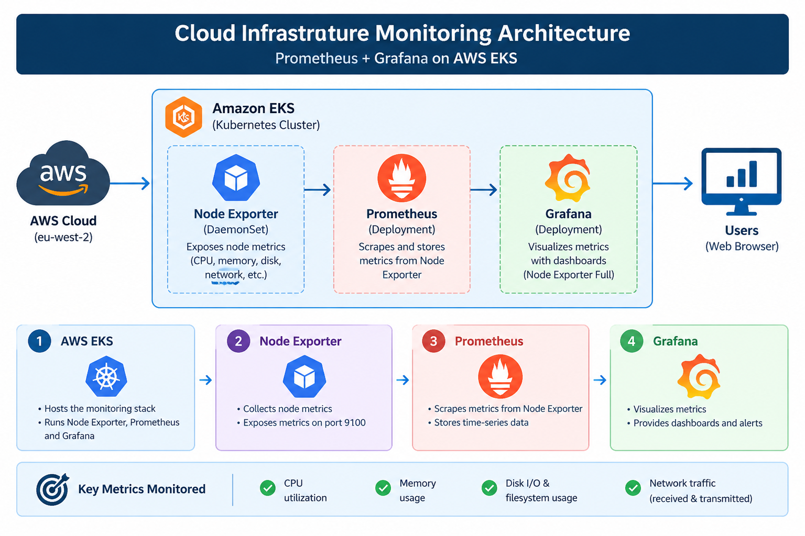

# Cloud Infrastructure Monitoring

## Objective
Deploy Prometheus and Grafana on AWS EKS to monitor cloud infrastructure metrics.

## Architecture

## Components
- AWS EKS: hosts the monitoring stack.
- Prometheus: collects and stores infrastructure metrics.
- Node Exporter: exposes node CPU, memory, disk, and network metrics.
- Grafana: visualizes metrics using the Node Exporter Full dashboard (ID 1860).

## Metrics Monitored
- CPU utilization
- Memory usage
- Disk I/O and filesystem usage
- Network traffic (received and transmitted)

## Configuration
Helm configuration is available in `config/prometheus-values.yaml`.

## Evidence
Dashboard screenshots are saved in the `screenshots/` directory.

## Access
Grafana was exposed through an AWS LoadBalancer service.
